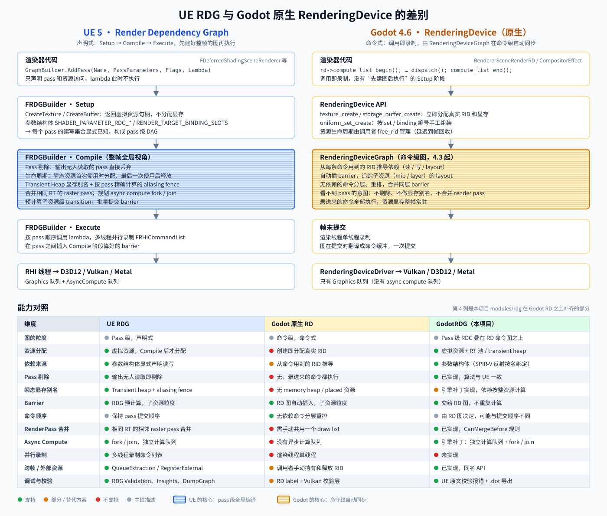
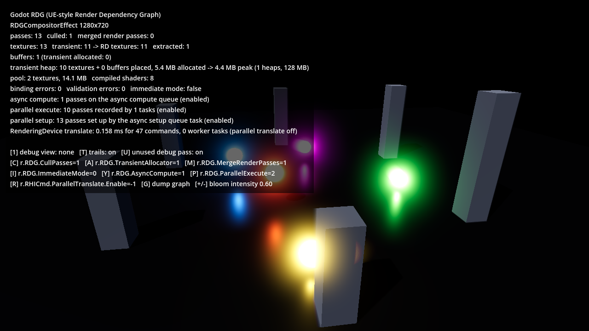
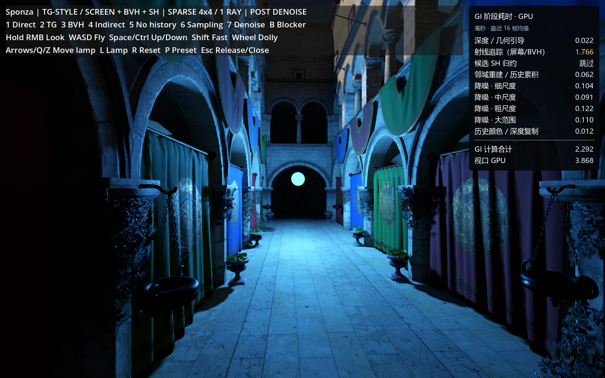

# GodotRDG

在 Godot 4.6 中复刻 UE 的 Render Dependency Graph（RDG），以引擎模块 `modules/rdg` 的形式实现。API 命名、写法和行为尽量与 UE 5 的 `RenderCore` 一致，pass 代码基本可以按 UE 的习惯直接写：`FRDGBuilder`、`BEGIN_SHADER_PARAMETER_STRUCT`、`FGlobalShader`、`FComputeShaderUtils::AddPass`、`FPixelShaderUtils::AddFullscreenPass`、`RDG_EVENT_SCOPE`、`QueueTextureExtraction` 等。

仓库里还有一个建在 RDG 上的完整用例：从 Godot-TopDown-GI（Godot Sparse GI）迁入的 TG 风格稀疏 GI 与阳光体积雾（引擎模块 `modules/tg_gi`），连同城市、Sponza、拱廊等场景，见 [TG GI 与大气雾](#tg-gi-与大气雾)。

## 概览

RDG 建在 `RenderingDevice`（RD）之上，形成两层图：

- 本模块负责 pass 级决策：虚拟资源、按参数结构体推导依赖、pass 剔除、资源生命周期、瞬态资源显存别名（transient heap）、async compute 的 fork / join、raster pass 合并、外部访问模式、并行 setup / compile、pass 并行录制、跨帧提取、校验和图导出。
- Godot 的 `RenderingDeviceGraph` 负责命令级同步：自动插 barrier、子资源状态跟踪、命令重排，以及两个队列之间的信号量。本模块不重复计算 barrier，`SetTextureAccessFinal` 等接口保留为空实现。



四项引擎级能力需要引擎补丁 `engine/rdg-engine.patch`（细节见[引擎改动](#引擎改动)），都已实现并验证：

| 能力 | UE 对应 | 默认 | 覆盖的测试 |
| --- | --- | --- | --- |
| 瞬态资源显存别名 | `IRHITransientResourceAllocator` / transient heap | 开（`r.RDG.TransientAllocator=1`），驱动不支持时退回资源池 | `TransientHeap*`、`TransientBufferAliasing` |
| Async compute 队列 | `ERHIPipeline::AsyncCompute`、fork / join | 开（`r.RDG.AsyncCompute=1`），需要独立的计算队列族 | `AsyncComputeForkJoin`、`AsyncComputeTransientFences` |
| Pass 并行录制 | `r.RDG.ParallelExecute`、并行命令列表 | 图带 `ERDGBuilderFlags::ParallelExecute` 时开 | `ParallelExecute*` |
| 命令图并行翻译 | parallel RHI translate | 关（项目设置 `rendering/rendering_device/parallel_translate`） | `ParallelTranslate` |

## 验证

在本机验证（NVIDIA RTX 5070，Vulkan 1.4）：

- `tests/run_tests.gd` 的 34 个自测全部通过，退出时没有 RD 资源泄漏。开启 Vulkan 同步校验层（`--gpu-validation` + synchronization validation）时没有任何校验错误；命令行强制 `r.RHICmd.ParallelTranslate.Enable=1 r.RHICmd.ParallelTranslate.MaxCommandsPerTranslate=-1`（所有帧都并行翻译、切到最碎）时也一样。
- 显存别名：去掉别名依赖做反向验证时，`TransientHeapAliasing` 必然失败（Godot 的图把后一个资源的写入排到了前一个资源的读取之前），说明该测试确实覆盖了别名同步。
- Async compute：队列建在独立的计算队列族上（RTX 5070 为族 2）。`AsyncComputeForkJoin` 检查提交结构：async pass 只等 fork 所在的提交，与之无关的图形 pass 不等待也不被等待，join pass 等 async 提交。去掉 join 信号量做反向验证时，同步校验层报 `SYNC-HAZARD-WRITE-RACING-WRITE`。
- 并行录制：`ParallelExecute` 用同一张图（计算链、清除、拷贝、上传、uniform buffer、合并的 raster pass，中间夹着留在渲染线程的 pass）分别串行、每任务 32 / 2 / 1 个 pass 执行，结果完全一致；`ParallelExecuteAliasing` 让每个 pass 各占一个任务，显存别名仍然正确。两个测试各连续跑 15 次全部通过；把录制上下文改成倒序提交做反向验证时，两个测试都失败。
- 并行翻译：`ParallelTranslate` 把命令切到最碎（每层的 barrier、计算链、清除、拷贝、render pass 都跨块），串行 / 并行录制、带 async compute 的帧结果都正确，连续 15 次通过。反向验证：去掉工作任务录制的 barrier 时校验层报 `SYNC-HAZARD-WRITE-AFTER-WRITE`，把同一次提交里的命令缓冲倒序时报 `SYNC-HAZARD-WRITE-AFTER-READ`，两种情况结果都错。
- 顶点 / 索引缓冲：`VertexAndIndexBuffers` 用顶点流 + 实例流（实例流由 compute pass 写入）画同一个 quad，分别用带 `BaseVertexIndex` 和 `StartIndex` 的索引绘制、带 `BaseVertexIndex` 的非索引绘制、索引间接绘制，串行和并行录制各跑一遍，逐像素检查。反向验证：忽略 `BaseVertexIndex` 或 `StartIndex` 时测试都失败。
- 外部访问模式：`ExternalAccessMode` 检查 access mode pass 读取资源（因而保留它的生产者）、外部访问期间的读取（包括 async compute pass）不产生依赖、`UseInternalAccessMode` 之后恢复跟踪，以及 3 种错误用法的校验。串行 setup 和异步 setup 队列各跑一遍。
- 并行 setup / compile：`ParallelSetup` 检查 setup 任务在工作线程上执行、前置任务、Compile / Execute 两个等待点、缓冲回调（元素数、数据、填充、释放）在 compile 任务上执行，以及异步 setup 队列设置 pass，串行和并行结果一致；连续 20 次通过。反向验证：跳过 Execute 等待点时测试失败。
- Demo：`demo/rdg_demo.tscn` 在 Forward+ 帧中运行 13 个 pass 的后处理图（Bloom、拖影历史帧、合成），剔除 1 个没人读取的调试 pass。10 个瞬态纹理放进同一个 heap，5.4 MB 的分配别名后峰值为 4.4 MB。拖影 pass 跑在 async compute 队列上，与 Bloom 链并行，在合成 pass 处 join。未剔除的 12 个 pass 中有 10 个由并行任务录制，另外 2 个是拖影 pass 和它的 fork / join 所在的图形 pass，按 UE 规则留在渲染线程。Bloom 之后调用 `FlushSetupQueue`，13 个 pass 都由异步 setup 队列任务设置。开同步校验层无错误。

CPU 耗时（16 个工作线程；256 pass 的图分 8 个录制任务，取多次运行中最好的一次）：

| 场景 | 串行 | 并行 | 测试 |
| --- | --- | --- | --- |
| `Execute()`，每 pass 1 次 dispatch | 0.45 ms | 0.38 ms | `ParallelExecuteTiming` |
| `Execute()`，每 pass 32 次 dispatch | 1.9 ms | 1.0 ms | `ParallelExecuteTiming` |
| RD 翻译 `end()`，每 pass 1 次 dispatch | 0.18 ms | 0.10–0.12 ms（3 个任务） | `ParallelExecuteTiming` |
| RD 翻译 `end()`，每 pass 32 次 dispatch | 1.7–1.8 ms | 0.57–0.66 ms（8 个任务 + 渲染线程） | `ParallelExecuteTiming` |
| Demo 整帧翻译（46 条 RD 命令） | 约 0.09 ms | 约 0.08 ms | `--measure-translate` |
| Setup + `Execute()`，256 个 pass，每 32 个 pass `FlushSetupQueue` | 0.12 + 0.43 ms | 0.15 + 0.44 ms | `ParallelSetupTiming` |
| 同上，加 4 个 setup 任务生成 4 MB 上传数据 | 3.9 + 1.5 ms | 0.2 + 2.2 ms | `ParallelSetupTiming` |

- 并行录制剩下的主要是渲染线程上的资源分配和按序提交；pass 的录制量越大，收益越明显。
- Demo 这种几十条命令的帧上，并行翻译的任务调度开销与收益相当，所以默认保持串行翻译。
- 异步 setup 队列本身没有收益：和 UE 一样，渲染线程在 `AddPass` 时仍要枚举一遍参数（标记被生产的资源、校验读依赖），而 pass 资源 setup 很便宜。256 个 pass 的 `Compile()` 约 70 µs。并行 setup 的收益来自 setup 任务本身（上表第二行快约一倍）；渲染线程在两次等待点之间做的事越多，重叠越多。



## 目录结构

| 路径 | 内容 |
| --- | --- |
| `modules/rdg/Public/` | 对外头文件，文件名与 UE `RenderCore` 对应（`RenderGraphBuilder.h`、`ShaderParameterMacros.h`、`GlobalShader.h` 等） |
| `modules/rdg/Private/` | 实现；`RDGEmbeddedShaders.gen.h` 由 `SCsub` 生成 |
| `modules/rdg/Shaders/` | 嵌入引擎的 GLSL，虚拟路径 `/Engine/...` |
| `modules/rdg/Tests/` | `RenderGraphTests` 自测类和测试 shader（`/RDGTests/...`） |
| `modules/rdg/Demo/` | `RDGCompositorEffect`，用 UE 写法实现的 CompositorEffect |
| `shaders/rdg_demo/` | Demo 的 GLSL，虚拟路径 `/Project/rdg_demo/...`；目录带 `.gdignore`，不让编辑器把它当 RDShaderFile 导入 |
| `demo/` | Demo 场景和 UI 脚本 |
| `modules/tg_gi/` | `TGScreenGI`（稀疏 GI，含历史捕获 `TGScreenGIHistory`）和 `TGSurfaceFog`（雾合成），UE 写法的 RDG pass |
| `shaders/tg/` | `TGScreenGI.glsl`、`TGSurfaceFog.glsl`，虚拟路径 `/Project/tg/...`；目录带 `.gdignore` |
| `shaders/`（其余）、`scripts/`、`scenes/`、`assets/`、`addons/native_baselines/`、`legacy_rc/` | 迁入的 GI / 雾演示：场景、GDScript（大气 `TGAtmosphere`、各演示）、材质 shader、旧盒体 GI 与 RC 副本、Kenney 城市模型 |
| `generated/`、`assets/sponza/glTF/` | Sponza 模型与预处理的 BVH / 材质数据，由 `tools/download-sponza.py` 和 `tools/prepare-sponza.ps1` 生成，不进仓库 |
| `docs/` | README 用的图；迁入的 GI / 雾文档（`TG_SCREEN_GI.md`、`TG_ATMOSPHERE.md`、`CITY_SCENE.md` 等）；目录带 `.gdignore` |
| `tests/run_tests.gd` | 命令行跑 RDG 自测；`tests/` 下其余脚本是旧盒体 GI 的测试 |
| `tools/build_engine.bat` | 编译带本模块的编辑器 |
| `tools/open-editor.ps1` | 用这个构建打开本项目的编辑器 |
| `addons/rdg_engine_check/` | 编辑器插件：编辑器里没有本模块的类时（例如双击 `project.godot` 打开了普通 Godot）弹窗说明原因 |
| `tools/*.ps1`、`tools/*.py` | GI / 雾演示的启动、验证和对比脚本（`run-tg.ps1`、`validate-tg-*.ps1` 等），见 [tools/README.md](tools/README.md) |
| `engine/rdg-engine.patch` | 引擎补丁（基于 4.6.1-stable `14d1969`）：RD 的内存堆、放置式资源、别名依赖、async compute 队列、录制上下文和并行翻译，以及给 `TGSurfaceFog` 用的原生体积雾接口；目录带 `.gdignore` |

## 编译

引擎改动在 Godot fork 的 [`rdg-engine` 分支](https://github.com/KisaragiTomi/godot/tree/rdg-engine)上（基于 4.6.1-stable `14d1969`），`engine/rdg-engine.patch` 是同一份改动的补丁。引擎源码用 `%GODOT_SOURCE%`（已有的 Godot 仓库）旁边的 git worktree `godot-rdg`，原有源码树不受影响。首次准备：

```bat
cd /d "%GODOT_SOURCE%"
git fetch https://github.com/KisaragiTomi/godot.git rdg-engine:rdg-engine
git worktree add ..\godot-rdg rdg-engine
```

不想拉分支时也可以用补丁：`git worktree add -b rdg-engine ..\godot-rdg 14d1969`，再在 `..\godot-rdg` 里 `git apply <本项目目录>\engine\rdg-engine.patch`。

模块通过 SCons 的 `custom_modules` 接入，不需要拷贝进引擎目录：

```bat
tools\build_engine.bat
```

- 引擎源码默认是 `%GODOT_SOURCE%\..\godot-rdg`，设置 `RDG_ENGINE_SOURCE` 可以换成别的目录。
- 产物是 worktree 里单独的 `bin\godot.windows.editor.x86_64.rdg.exe`（`extra_suffix=rdg`），不覆盖原有的编辑器和 obj。
- 带 `d3d12=no`：本机没有 `%LOCALAPPDATA%\Godot\build_deps` 里的 D3D12 依赖。装好依赖后可以去掉。
- 额外参数会透传给 SCons，例如 `tools\build_engine.bat dev_build=yes`。
- 首次全量编译约 10 分钟（`scu_build=yes`），之后改模块只需十几秒；改 `rendering_device.h` 会触发接近全量的重编。
- 修改引擎后在 worktree 里提交到 `rdg-engine` 分支，再用 `git diff 14d1969 -- servers drivers > <本项目目录>\engine\rdg-engine.patch` 重新导出补丁。

编辑器也要用这个构建打开：

```powershell
./tools/open-editor.ps1
```

双击 `project.godot` 会用系统关联的普通 Godot。它没有 `RDGCompositorEffect`、`RenderGraphConsole`、`TGScreenGI` 等引擎类，用到它们的脚本都报解析错误，`DemoViewer` 自动加载也会失败；这时 `RDG Engine Check` 插件会弹窗说明原因。

## 运行测试与 Demo

```bat
"%GODOT_SOURCE%\..\godot-rdg\bin\godot.windows.editor.x86_64.rdg.console.exe" --path . --rendering-driver vulkan --script res://tests/run_tests.gd
```

- 加 `--headless` 时只跑 3 个 CPU 测试，GPU 测试会标记 `SKIP`；完整验收必须用非 headless 的 Vulkan。
- 只跑某个测试：在命令末尾加 `-- --test=MipViews`。
- 驱动不支持内存堆时，`TransientHeap*` 测试标记 `SKIP`，RDG 自动退回资源池。
- 设备没有独立计算队列族（或项目设置 `rendering/rendering_device/async_compute` 为 `false`）时，`AsyncCompute*` 测试只检查结果，然后标记 `SKIP`。
- RD 只在启用 Vulkan debug utils（`--verbose` 或校验层）时记录 label。`AsyncComputeForkJoin` 有 label 时按 pass 名找提交，没有时按提交顺序识别。
- 同步校验：本机没装 Vulkan SDK，可以借用 UE 自带的校验层（`UE_ROOT` 指 UE 的安装目录），再加 `--gpu-validation`：

```bat
set VK_LAYER_PATH=%UE_ROOT%\Engine\Binaries\ThirdParty\Vulkan\Win64
set VK_LAYER_ENABLES=VK_VALIDATION_FEATURE_ENABLE_SYNCHRONIZATION_VALIDATION_EXT
```

```bat
"%GODOT_SOURCE%\..\godot-rdg\bin\godot.windows.editor.x86_64.rdg.exe" --path . --rendering-driver vulkan
```

Demo 按键：

| 按键 | 作用 |
| --- | --- |
| `1` | 调试视图：无 / Bloom / Bloom Setup |
| `T` | 拖影（历史帧提取 + 注册） |
| `U` | 是否添加没人读取的调试 pass（用于观察剔除） |
| `C` / `A` / `M` / `I` | 切换 `r.RDG.CullPasses` / `TransientAllocator`（transient heap 与资源池）/ `MergeRenderPasses` / `ImmediateMode` |
| `Y` | 切换 `r.RDG.AsyncCompute`（拖影 pass 在 async compute 队列与图形队列之间切换） |
| `P` | 切换 `r.RDG.ParallelExecute`（Demo 的图带 `ERDGBuilderFlags::Parallel`） |
| `R` | 切换 `r.RHICmd.ParallelTranslate.Enable`（整帧的 RD 命令图在工作线程上翻译），左上角显示上一帧的翻译耗时和任务数 |
| `G` | 把下一帧的图导出为 Graphviz `.dot` |
| `+` / `-` | Bloom 强度 |

Console 变量也可以从命令行设置，写在 `--` 之后：

```bat
"%GODOT_SOURCE%\..\godot-rdg\bin\godot.windows.editor.x86_64.rdg.exe" --path . -- r.RDG.ImmediateMode=1 r.RDG.Debug=1
```

测量 Demo 的翻译耗时：`--measure-translate[=块数]` 预热 120 帧后每 60 帧切换一次串行 / 并行翻译（默认 8 块），打印两种模式的平均值和中位数后退出。开校验层时的耗时没有参考价值（校验层内部有锁）。

```bat
"%GODOT_SOURCE%\..\godot-rdg\bin\godot.windows.editor.x86_64.rdg.console.exe" --path . --rendering-driver vulkan -- --measure-translate=8
```

## TG GI 与大气雾

从 Godot-TopDown-GI（Godot Sparse GI）迁入：支持自由相机的实时漫反射 GI 和阳光体积雾，以及城市、Sponza、拱廊、旧盒体 GI 等演示。原项目的 GI 和雾合成是 GDScript + RD 的 CompositorEffect，迁入时改写为引擎模块 `modules/tg_gi` 里的 UE 写法 RDG 代码，GDScript 接口不变（`sponza_lab.gd` 等照常调用）。算法和历次验证记录见 [TG 实现说明](docs/TG_SCREEN_GI.md)、[大气雾说明](docs/TG_ATMOSPHERE.md)、[城市场景](docs/CITY_SCENE.md)。



### RDG 写法

`TGScreenGI` 在不透明 pass 之前执行（材质在不透明 pass 中采样它的 `sh_texture` / `position_texture` / `normal_texture`），`history_effect` 在不透明 pass 之后保存本帧的辐射度和深度。原版一个 shader 用 specialization constant 分 12 个阶段，所有阶段共用一个 37 个 binding 的 descriptor set；RDG 版每个阶段一个 `FGlobalShader`（`shaders/tg/TGScreenGI.glsl` 的一个入口），每个入口只声明自己读写的资源：

| Pass | Shader | 读 | 写 |
| --- | --- | --- | --- |
| Guide | `FTGGuideCS` | 深度、法线 | `GuidePosition` / `GuideNormal`（半分辨率） |
| Budget（自适应采样） | `FTGBudgetCS` | 引导、上一帧统计 | `RayBudget` |
| Trace | `FTGTraceCS`（排列：自适应、世界缓存） | 引导、深度、上一帧辐射度、BVH、材质贴图数组 | `CandidateColor` / `CandidateDirection`（2D 数组，每层一条射线） |
| Project（非稀疏采样） | `FTGProjectCS` | 候选 | `CandidateSH` |
| Reconstruct | `FTGReconstructCS`（排列：稀疏） | 候选、上一帧 SH / 年龄 / 矩 | SH、年龄、矩 |
| Filter ×4 / BasicFilter | `FTGFilterCS`（排列：级别 3/6/7/8）/ `FTGBasicFilterCS` | SH 或上一级 | 下一级 → 最终 `Filtered` + 显示引导 |
| WorldCacheSelect / Resolve | `FTGCacheSelectCS` / `FTGCacheResolveCS` | 引导、`Filtered` | 世界缓存（持久缓冲） |
| History（不透明 pass 之后） | `FTGHistoryCS`（排列：表面历史） | 场景颜色、深度 | 下一帧用的颜色 / 深度历史 |

- 所有 pass 共用一个参数结构体 `FTGScreenGIParameters`，帧常量放在 uniform buffer `TGView`。每个 pass 都填同一组帧级输入，由 `FComputeShaderUtils::AddPass` 的 `ClearUnusedGraphResources` 按该 shader 的声明清掉不用的成员，所以 RDG 推导出的依赖就是真实的读写关系。
- 候选、预算、各级滤波和方差纹理是 RDG 瞬态资源，由 transient heap 分配并共享显存。引导、SH、年龄、矩和颜色 / 深度历史用 `QueueTextureExtraction` 提取，下一帧再 `RegisterExternalTexture`，与 UE 的 view state 历史写法相同。窗口尺寸改变后没有可用历史时，读到的是清零的纹理，与原版新建的零纹理等价。
- 材质引用的三张纹理（`Filtered`、显示用位置 / 法线）是 `AllocatePooledTexture` 分配的持久纹理，只在尺寸改变时重建，保证 `Texture2DRD` 的身份不变。BVH、三角形、材质缓冲和贴图数组是普通 RD 资源，每帧作为外部资源注册。
- 各阶段 GPU 计时用新加的 `RDG_GPU_STAT_SCOPE`（`r.RDG.GPUStats`），时间戳名与原版相同（`TG pass trace begin` 等），统一面板和验证脚本无需改动。
- `TGSurfaceFog` 是一个 `FPixelShaderUtils::AddFullscreenPass`：把 Godot 原生体积雾的 froxel 纹理（引擎补丁的 `RenderSceneBuffersRD::get_volumetric_fog_texture()`）以 `S + T × surface` 混合到原来的（MSAA）颜色附件上，在天空和透明物体之前执行。MSAA 时用 `gl_SampleID` 逐样本执行。
- `TGAtmosphere`（雾的密度、散射与天空源项）仍是 GDScript + `FogVolume` 的 fog shader，由 Godot 原生体积雾积分，不经过 RDG。

### 首次运行

需要 Python 3.11+（`tools/requirements.txt`）和本项目的引擎构建（见[编译](#编译)）。启动脚本通过 `tools/resolve-godot.ps1` 找 `%GODOT_SOURCE%\..\godot-rdg\bin\` 下的 rdg 构建，也可以用 `GODOT_EXE` 指定。城市和拱廊不需要下载；Sponza 需要先下载模型并生成 BVH 与材质数据（只是静态几何加速数据，不烘焙照明）：

```powershell
python -m venv .venv
./.venv/Scripts/python.exe -m pip install -r tools/requirements.txt
./.venv/Scripts/python.exe tools/download-sponza.py
./tools/prepare-sponza.ps1 -Python ./.venv/Scripts/python.exe
./tools/run-tg.ps1
```

### 运行

| 命令 | 场景 |
| --- | --- |
| `./tools/run-tg.ps1` | Sponza + TG GI；`-Atmosphere` 加大气预设（雾 + 共享天空光），`-Sampling Adaptive / Quality`、`-BasicFilter`、`-WorldCache`、`-NoSky` |
| `./tools/run-city.ps1` | 城市大气场景（Kenney 模型，约 464×464 米） |
| `./tools/run-atmosphere.ps1` | 拱廊阳光体积雾，不需要 Sponza |
| `./tools/run-sponza.ps1`、`run-lab.ps1`、`run-ball.ps1`、`run-emissive.ps1` | 旧的世界空间表面缓存 GI 对照实验 |

各脚本加 `-Capture` 运行自动检查并保存截图到 `artifacts/`（目录带 `.gdignore`，Godot 不导入其中的截图）。`F1` / `F2` / `F3` 在城市、Sponza（GI + 雾）、拱廊之间切换，左下角显示雾和 GI 各自的 GPU 耗时。所有演示共用自由相机，按键与通用飞行相机（`%GODOT_SOURCE%\misc\shared_scripts\fly_camera.gd`）一致：按住鼠标右键转向，`WASD` 移动，`E` / `Space` 上升，`Q` 下降，`Shift` 2.5 倍速，滚轮调移动速度；`P` 恢复观察预设，`R` 复位。

Sponza TG 按键：`1` / `2` 无 GI / TG，`3` 只走 BVH，`4` 仅间接光，`5` 关闭 GI 历史，`6` 切换稀疏 / 自适应 / 高采样预算，`7` 切换后期降噪与基础滤波，`8` 开关天空光，`9` 开关世界缓存，`B` 移动遮挡板，方向键和 `PgUp` / `PgDn` 移灯。城市：`P` 或 `1` / `2` / `3` 切换航拍、街道、广场，`F` 开关雾，`V` 切换雾的采样质量，方向键转太阳。

### 迁移验证

RTX 5070 / Vulkan 1.4，1280×800，与原项目（GDScript 版，原项目自带的 fog 引擎）同条件对照：

- `run-tg.ps1 -Capture`（Sponza，默认稀疏采样）全部检查通过：重投影、尺寸变化、移灯、遮挡板、关灯归零、TAA 历史都正常。GI GPU 中位数 1.19 ms，原版 1.21 ms；视口 GPU 2.30 ms，原版 2.38 ms。
- 截图逐像素对比（两边用同一份贴图导入缓存，否则 GPU 压缩贴图的差异会让纯直接光图也不同）：直接光图完全一致；GI、仅间接光、仅 BVH、无历史、移灯、遮挡板、移动相机等 8 张图的 MAE 不超过 0.0005（0–1 RGB），P99 为 0，与原版自己两次运行之间的差异（0.0002–0.0003）同一量级。
- `run-tg.ps1 -Atmosphere -Capture`（表面辐射缓存 + `TGSurfaceFog` 合成）：结果 JSON（包括 GPU 计数器）与原版完全相同，三张截图逐像素一致。
- `tools/` 下的全部验证在本项目的引擎构建上通过（2026-10-23）：`validate-tg-fog-history`、`validate-tg-sky`、`validate-tg-world-cache`、`validate-tg-camera`、`validate-tg-adaptive`、`validate-tg-post`、`validate-tg-noise`、`validate-atmosphere-quality`、`validate-city-fog`、`validate-bvh`，`run-atmosphere` / `run-city` / `run-sponza -Capture`，`validate-tg-timing.gd`、`validate-viewer.gd`、`validate-free-camera.gd`，以及旧表面缓存 GI 的 `validate.ps1 -BakeLightmap -Emissive -Ball`。旧实验脚本显式打开 `res://scenes/lab.tscn`，因为本项目的主场景是 RDG Demo。

### 已知限制

- `TGScreenGI` / `TGSurfaceFog` 现在是引擎类，原项目的 GDScript 同名类不能再在这个引擎上加载；标准 Godot 也不能运行这些场景，需要本项目的引擎构建。
- `read_debug()` 读取的候选纹理是瞬态资源：默认要等下一帧把它们提取出来（多一帧延迟）。验证和截图脚本会打开 `debug_readback`，每帧提取，读取时与原版一样立即返回。
- GI shader 以文件方式从带 `.gdignore` 的 `res://shaders/tg/` 读取，导出项目时需要把它加入导出的非资源文件。

## 写一个 RDG Pass

C++ 侧与 UE 写法相同（示例取自 `modules/rdg/Tests/RenderGraphTests.cpp`）：

```cpp
class FTestAddValueCS : public FGlobalShader {
	DECLARE_GLOBAL_SHADER(FTestAddValueCS);
	SHADER_USE_PARAMETER_STRUCT(FTestAddValueCS, FGlobalShader);

	BEGIN_SHADER_PARAMETER_STRUCT(FParameters, )
	SHADER_PARAMETER(FIntPoint, Size)                                    // push constant 成员
	SHADER_PARAMETER(float, Value)                                       // push constant 成员
	SHADER_PARAMETER_RDG_TEXTURE(Texture2D, InputTexture)                // 读：SRV
	SHADER_PARAMETER_RDG_TEXTURE_UAV(RWTexture2D<float>, OutputTexture)  // 写：UAV
	END_SHADER_PARAMETER_STRUCT()
};
IMPLEMENT_GLOBAL_SHADER(FTestAddValueCS, "/RDGTests/RDGTestCompute.glsl", "AddValueCS", SF_Compute);

void AddValuePass(FRDGBuilder &GraphBuilder, FRDGTextureRef Input, FRDGTextureRef Output) {
	TShaderMapRef<FTestAddValueCS> ComputeShader(GraphBuilder.GetShaderMap());
	FTestAddValueCS::FParameters *PassParameters = GraphBuilder.AllocParameters<FTestAddValueCS::FParameters>();
	PassParameters->Size = Output->Desc.Extent;
	PassParameters->Value = 2.5f;
	PassParameters->InputTexture = Input;
	PassParameters->OutputTexture = GraphBuilder.CreateUAV(Output);
	FComputeShaderUtils::AddPass(GraphBuilder, RDG_EVENT_NAME("AddValue"), ComputeShader, PassParameters, FComputeShaderUtils::GetGroupCount(Output->Desc.Extent, 8));
}
```

主 RenderingDevice 上用 `FRHICommandListExecutor::GetImmediateCommandList()` 和 `GetGlobalShaderMap(GMaxRHIFeatureLevel)`；在 CompositorEffect 回调里注册 Godot 的场景颜色：

```cpp
FRHICommandListImmediate &RHICmdList = FRHICommandListExecutor::GetImmediateCommandList();
FRDGBuilder GraphBuilder(RHICmdList, RDG_EVENT_NAME("MyPostProcess"));
FRDGTextureRef SceneColor = RegisterExternalTexture(GraphBuilder, RenderSceneBuffers->get_internal_texture(0), TEXT("SceneColor"));
// ... AddPass ...
GraphBuilder.Execute();
```

完整示例见 `modules/rdg/Demo/RDGCompositorEffect.cpp`。本地 RenderingDevice 需要自己构造 `FRHICommandListImmediate(LocalDevice)`，用完后先调用 `FRDGDeviceContext::Release(LocalDevice)`（脚本里是 `RenderGraphConsole.release_device(rd)`）再释放设备。

顶点 / 索引缓冲与 UE 写法相同：缓冲在 pass 参数里用 `RDG_BUFFER_ACCESS(..., ERHIAccess::VertexOrIndexBuffer)` 声明（索引缓冲的 desc 再加 `BUF_IndexBuffer`），lambda 里设置顶点声明和 stream（完整示例见 `TestVertexAndIndexBuffers`）：

```cpp
FVertexDeclarationElementList Elements;
Elements.push_back(FVertexElement(0, offsetof(FVertex, Position), VET_Float2, 0, sizeof(FVertex)));
Elements.push_back(FVertexElement(1, offsetof(FInstance, Offset), VET_Float2, 1, sizeof(FInstance), true));  // 每实例
GraphicsPSOInit.BoundShaderState.VertexDeclarationRHI = PipelineStateCache::GetOrCreateVertexDeclaration(Elements);
SetGraphicsPipelineState(RHICmdList, GraphicsPSOInit, 0);
RHICmdList.SetStreamSource(0, PassParameters->VertexBuffer->GetRHI(), 0);
RHICmdList.SetStreamSource(1, PassParameters->InstanceBuffer->GetRHI(), 0);
RHICmdList.DrawIndexedPrimitive(PassParameters->IndexBuffer->GetRHI(), BaseVertexIndex, 0, NumVertices, StartIndex, NumPrimitives, NumInstances);
```

并行 setup：图带 `ERDGBuilderFlags::ParallelSetup | ParallelCompile`（或 `Parallel`）时，setup 任务在工作线程上准备数据，缓冲的元素数和内容由回调在编译时取：

```cpp
LocalVector<FInstance> Instances;  // 活到 Execute() 结束
GraphBuilder.AddSetupTask([&Instances] { BuildInstances(Instances); });  // Compile 前同步
FRDGBufferRef InstanceBuffer = CreateStructuredBuffer(GraphBuilder, "Instances", sizeof(FInstance),
		[&Instances] { return (uint32)Instances.size(); },
		[&Instances] { return (const void *)Instances.ptr(); },
		[&Instances] { return (uint64)Instances.size() * sizeof(FInstance); });
```

## Shader 约定

Shader 用 GLSL（glslang 编译为 SPIR-V），对应的 GLSL 片段：

```glsl
#ifdef AddValueCS                                       // 入口名被 #define 成 main，可用来隔离各入口的资源
layout(local_size_x = 8, local_size_y = 8) in;
layout(set = 0, binding = 0) uniform texture2D InputTexture;                       // 按名字绑定
layout(set = 0, binding = 1, r32f) uniform restrict writeonly image2D OutputTexture;
layout(push_constant, std430) uniform FParameters {     // 松散参数按成员名写入 push constant
	ivec2 Size;
	float Value;
};
void AddValueCS() { /* ... */ }
#endif
```

- 绑定按名字匹配：反射 SPIR-V 中的描述符名、push constant 成员名，与参数结构体成员名对应，`set`/`binding` 编号可以任意写。嵌套结构体按 UE 规则展平为 `Struct_Member`。
- 一个文件可以有多个入口：`IMPLEMENT_GLOBAL_SHADER` 的入口名会被 `#define` 成 `main`；同时定义 `COMPUTESHADER` / `VERTEXSHADER` / `PIXELSHADER`。
- 虚拟路径：`/Engine/...` 是嵌入模块的 shader，`/Project/...` 映射到 `res://shaders/...`，也可以直接写 `res://` 路径。支持 `#include`，自动带 `GL_EXT_samplerless_texture_functions`。
- 排列组合：`SHADER_PERMUTATION_BOOL` / `INT` / `RANGE_INT` / `SPARSE_INT` / `ENUM_CLASS` + `TShaderPermutationDomain`，维度会自动写成 `#define`。
- Uniform buffer：`BEGIN_UNIFORM_BUFFER_STRUCT` + `IMPLEMENT_UNIFORM_BUFFER_STRUCT(FStruct, "Name")`，GLSL 用 `uniform Block { ... } Name;`（std140）；结构体里的资源成员在 GLSL 中声明为独立描述符 `Name_Member`。
- 采样器：推荐与 UE 一样分离的 `texture2D` + `sampler`；若用组合采样器 `sampler2D X`，会找名为 `XSampler` 的 `SHADER_PARAMETER_SAMPLER`，找不到时用默认双线性采样器。
- Shader 中声明但参数结构体没有的描述符会报 `unbound parameter` 错误并跳过该 dispatch/draw；Godot 要求 uniform set 覆盖全部声明的绑定，所以不用的资源要用 `#ifdef`/`#if` 去掉。
- Pixel shader 从 `layout(location = 0) in vec2 UV;` 读全屏三角形的 UV（`FScreenVertexShaderVS`，左上角为 `(0, 0)`）。

## UE API 对照

| 功能 | 状态 | 说明 |
| --- | --- | --- |
| `FRDGBuilder`：`CreateTexture/Buffer/SRV/UAV`、`AllocParameters`、`AddPass`、`Execute` | 已实现 | lambda 支持 `(FRHICommandList&)` 和 `(FRDGAsyncTask, FRHICommandList&)` |
| 参数结构体宏（`SHADER_PARAMETER*`、`RDG_*_ACCESS`、`RENDER_TARGET_BINDING_SLOTS`、`SHADER_PARAMETER_STRUCT(_INCLUDE/_ARRAY)`） | 已实现 | 与 UE 相同的成员链式元数据技巧 |
| Pass 剔除（`NeverCull`、外部/提取资源为根） | 已实现 | 算法与 UE `AddCullingDependency` / `FlushCullStack` 一致 |
| 瞬态资源（`IRHITransientResourceAllocator`、`FRHITransientHeap`） | 已实现（需引擎补丁） | 放进 RD 内存堆，首次使用时分配、最后一次使用后释放，不同 desc 的资源共享显存；放置失败时退回资源池 |
| 跨帧池（`GRenderTargetPool`） | 已实现 | 未使用超过 `r.RDG.ResourcePool.FramesUntilRelease` 帧后释放 |
| `QueueTextureExtraction` / `RegisterExternalTexture` / `ConvertToExternal*` | 已实现 | 被提取资源不会标记为 discardable |
| `QueueBufferUpload`、`CreateStructuredBuffer` 等 | 已实现 | 含数据 / 填充 / 释放回调，以及 `CreateBuffer` 的元素数回调（编译时取值） |
| `UseExternalAccessMode` / `UseInternalAccessMode` | 已实现 | access mode pass 与 UE `FlushAccessModeQueue` 一致；外部访问期间的 pass 不产生依赖、不延长生命周期；`SkipTracking` 资源锁定在外部访问模式 |
| 顶点 / 索引缓冲（`FRHIVertexDeclaration`、`FVertexElement`、`SetStreamSource`、`DrawIndexedPrimitive(Indirect)`） | 已实现 | 用 `ERHIAccess::VertexOrIndexBuffer` 声明的缓冲分配为 RD 顶点 / 索引缓冲；顶点格式进 pipeline 缓存的键 |
| Raster pass 合并 | 已实现 | 与 UE `CanMergeBefore` 规则一致，合并为一个 RD draw list |
| `FGlobalShader`、`TShaderMapRef`、排列组合、`ModifyCompilationEnvironment` | 已实现 | 首次使用时按需编译并缓存 |
| `FComputeShaderUtils`、`FPixelShaderUtils::AddFullscreenPass` | 已实现 | 含间接 dispatch |
| `AddClearUAVPass`、`AddCopyTexturePass`、`AddCopyBufferPass`、`AddClearRenderTargetPass` | 已实现 | |
| `FRHIGPUBufferReadback` / `FRHIGPUTextureReadback`、`AddEnqueueCopyPass` | 已实现 | 基于 `buffer/texture_get_data_async` |
| `RDG_EVENT_SCOPE`、`RDG_EVENT_NAME` | 已实现 | 生成 `图名/作用域/Pass` 形式的 RD label（RenderDoc 可见） |
| `DECLARE_GPU_STAT(_NAMED)`、`RDG_GPU_STAT_SCOPE` | 已实现 | 作用域内的 pass 用 RD 时间戳计时（`r.RDG.GPUStats`），结果从 `RenderingDevice.get_captured_timestamp_*` 读；没有 UE 的 stat 汇总界面 |
| `FRDGBlackboard`、`RDG_REGISTER_BLACKBOARD_STRUCT` | 已实现 | |
| 校验（读未写资源、lambda 访问未声明资源、提取未生产资源、pass 标志、RT 打包） | 已实现 | 报错文本沿用 UE 原文 |
| Immediate 模式、`r.RDG.DumpGraph` | 已实现 | 导出到 `user://rdg/*.dot` |
| Async compute（`ERDGPassFlags::AsyncCompute`、fork / join、`FRHITransientAllocationFences`） | 已实现（需引擎补丁） | `AsyncCompute` pass 跑在 RD 的 async compute 队列上；fork / join pass 的计算与 UE `Compile` 一致；没有独立计算队列时自动变为 `Compute` |
| 并行录制（`ERDGBuilderFlags::ParallelExecute`、`ERDGPassFlags::NeverParallel`） | 已实现（需引擎补丁） | 连续可并行的 pass 分成 parallel pass set，每个 set 一个 `WorkerThreadPool` 任务，录进 RD 录制上下文后按 pass 顺序提交；分组规则同 UE `SetupParallelExecute` |
| 并行 setup / compile（`ERDGBuilderFlags::ParallelSetup` / `ParallelCompile`、`AddSetupTask`、`FlushSetupQueue`） | 已实现 | setup 任务在 `WorkerThreadPool` 上执行，Compile / Execute 两个等待点，支持前置任务；异步 setup 队列在任务上设置 pass 资源；`ParallelCompile` 时缓冲回调在任务上执行，与 `Compile()` 重叠 |
| 并行翻译（`r.RHICmd.ParallelTranslate.*`） | 已实现（需引擎补丁，默认关闭） | RD 在帧末把排好序的命令切块，工作任务各录一个主命令缓冲，按顺序在同一次 `vkQueueSubmit` 中提交 |

## Console 变量

| 名称 | 默认 | 作用 |
| --- | --- | --- |
| `r.RDG.ImmediateMode` | `0` | pass 在 `AddPass` 时立即执行，便于定位接线代码 |
| `r.RDG.AsyncCompute` | `1` | `0` 不用 async compute；`1` 标了 `AsyncCompute` 的 pass 跑在 async compute 队列；`2` 所有 `Compute` pass 都跑在 async compute 队列 |
| `r.RDG.ParallelExecute` | `2` | `0` 关闭；`1` / `2` 带 `ParallelExecute` 标志的图并行录制 pass（`2` 在 UE 中是不等待的异步任务；这里录制结果要在渲染线程提交，`Execute()` 返回前总会等任务完成，所以与 `1` 相同） |
| `r.RDG.ParallelExecute.PassMin` | `1` | 少于这么多 pass 的连续可并行区间不交给任务 |
| `r.RDG.ParallelExecute.PassMax` | `32` | 一个任务最多录制的连续 pass 数 |
| `r.RDG.ParallelSetup` | `1` | 带 `ParallelSetup` 标志的图把 `AddSetupTask` 交给任务；`0` 在调用处直接执行 |
| `r.RDG.AsyncSetupQueue` | `1` | 并行 setup 时 pass 资源 setup 进队列，由 `FlushSetupQueue` 启动的任务处理，剩下的在 `Execute()` 中处理；`0` 在 `AddPass` 中同步 setup |
| `r.RDG.ParallelCompile` | `1` | 带 `ParallelCompile` 标志的图在 `Compile()` 期间用任务执行缓冲回调；`0` 在渲染线程执行 |
| `r.RHICmd.ParallelTranslate.Enable` | `-1` | RD 是否在工作线程上翻译命令图：`-1` 跟随项目设置 `rendering/rendering_device/parallel_translate`（默认 `false`）；`0` 关；`1` 开。每次构造 `FRDGBuilder` 时写入该图的 RD |
| `r.RHICmd.ParallelTranslate.MaxCommandsPerTranslate` | `256` | 每个翻译任务的目标命令数；compute / draw list 按录制的指令数计（约等于驱动调用数）。`0` 不切分，负数总是切到最碎 |
| `r.RDG.CullPasses` | `1` | 剔除输出未被使用的 pass |
| `r.RDG.MergeRenderPasses` | `1` | 合并相同 RT 的相邻 raster pass |
| `r.RDG.TransientAllocator` | `1` | `1` 瞬态资源放进 transient heap 并别名显存；`0` 从资源池取，最后一次使用后归还 |
| `r.RDG.TransientAllocator.IndirectArgumentBuffers` | `0` | 间接参数缓冲是否走 transient heap（与 UE 默认相同，不走） |
| `RHI.TransientAllocator.MinimumHeapSize` | `128` | 单个 heap 的最小容量（MB），更大的资源会建更大的 heap |
| `RHI.TransientAllocator.GarbageCollectLatency` | `16` | 放置式资源和空 heap 闲置多少帧后释放 |
| `RHI.TransientAllocator.TextureCacheSize` | `64` | 每个 heap 最多缓存的放置式纹理数 |
| `RHI.TransientAllocator.BufferCacheSize` | `64` | 每个 heap 最多缓存的放置式缓冲数 |
| `r.RDG.ClobberResources` | `0` | 分配时用哨兵值清空资源，排查未初始化读取 |
| `r.RDG.Debug` | `0` | 额外警告（例如无参数且未标 `NeverCull` 的 pass） |
| `r.RDG.Validation` | `1` | 校验开关 |
| `r.RDG.DumpGraph` | `0` | `1` 每张图都导出，`2` 导出下一张后自动归零 |
| `r.RDG.Events` | `1` | 为每个 pass 发 RD debug label |
| `r.RDG.GPUStats` | `1` | 用 RD 时间戳给每个 `RDG_GPU_STAT_SCOPE` 计时，名字为 `"<Stat> begin"` / `"<Stat> end"`（`RenderingDevice.get_captured_timestamp_*`，晚一帧可读）。async compute 队列上的 pass 和并行录制的 pass 不计时 |
| `r.RDG.ResourcePool.FramesUntilRelease` | `30` | 空闲池元素保留帧数 |
| `r.RDG.Cache.FramesUntilRelease` | `120` | 未使用的 uniform set / framebuffer 缓存保留帧数 |
| `r.RDG.ShaderCompileCache` | `1` | 使用 Godot 的 SPIR-V 编译缓存 |
| `r.RDG.DumpShaderSource` | `0` | 打印每个排列预处理后的 GLSL |

脚本接口：`RenderGraphConsole.set_cvar(name, value)`、`get_cvar`、`get_cvar_list`、`get_pool_stats`（含 `transient_*` 堆统计）、`recompile_shaders`、`tick_pool_elements`。

## 引擎改动

`engine/rdg-engine.patch` 给 RD 增加放置式资源（placed resources），对应 UE RHI 的 transient heap 能力：

```cpp
RID memory_heap_create(uint64_t p_size_bytes);                    // 一块 GPU 内存，驱动不支持时返回无效 RID
bool texture_get_memory_requirements(const TextureFormat &, MemoryRequirements &);   // size / alignment
RID texture_create_placed(const TextureFormat &, const TextureView &, RID p_heap, uint64_t p_offset);
bool storage_buffer_get_memory_requirements(uint32_t p_size_bytes, BitField<StorageBufferUsage>, MemoryRequirements &);
RID storage_buffer_create_placed(uint32_t p_size_bytes, BitField<StorageBufferUsage>, RID p_heap, uint64_t p_offset);
void resource_aliasing_acquire(RID p_resource, VectorView<RID> p_overlapping_resources);  // UE 的 FRHITransientAliasingInfo::Acquire
```

- Vulkan 驱动：heap 是一块 VMA 专用内存（`vmaAllocateMemory`），放置式资源用 `vmaBindImageMemory2` / `vmaBindBufferMemory2` 绑到偏移上；对齐取 `max(alignment, bufferImageGranularity)`，纹理和缓冲可以放进同一个 heap。
- RD 图：`resource_aliasing_acquire` 记录与之重叠的资源在本帧的最后写入和之后的读取，资源下一次被使用的命令依赖它们，并带上 `MEMORY_WRITE → MEMORY_READ|WRITE` 内存屏障；资源布局重置为 `UNDEFINED`。这一步不能省：Godot 会把没有依赖的命令放进同一层并行执行。
- 释放 heap 会先释放放在其中的资源（RD 依赖）；heap 与纹理、缓冲一样延迟到帧回收时才真正释放。
- 不能放置的资源：CPU 可读、lazily allocated（`TEXTURE_USAGE_TRANSIENT_BIT`）、VRS、带初始数据的纹理，以及 dynamic persistent 缓冲。
- 只实现了 Vulkan；其它驱动用基类的默认实现（返回空 ID），RDG 自动退回资源池。

补丁还给 RD 增加 async compute 队列，对应 UE 的 `ERHIPipeline::AsyncCompute`：

```cpp
bool async_compute_is_supported() const;                 // 有独立计算队列族时为 true
void async_compute_begin();                              // 之后录制的 compute list、拷贝、更新、颜色清除进 async compute 队列
void async_compute_end();                                // 回到主队列
AsyncComputeFence async_compute_fork_signal();           // fork：主队列到此为止的命令
void async_compute_fork_wait(const AsyncComputeFence &); // 之后录制的 async compute 命令等它
AsyncComputeFence async_compute_join_signal();           // join：async compute 队列到此为止的命令
void async_compute_join_wait(const AsyncComputeFence &); // 之后录制的主队列命令等它
const Vector<AsyncComputeSubmissionInfo> &async_compute_get_last_frame_submissions() const;  // 上一个用了 async compute 的帧的提交结构（调试 / 测试）
```

- 队列：`initialize` 用 `command_queue_family_get(COMPUTE_BIT)` 选位数最少的计算队列族，与主队列族不同才创建 async compute 队列；之后创建的纹理和缓冲对主队列、async compute、传输队列族用 `VK_SHARING_MODE_CONCURRENT`（与 UE Vulkan RHI 默认的 `r.Vulkan.AllowConcurrentImage/Buffer` 相同），不做队列族所有权转移。每帧有一个 async compute 命令池。
- RD 图：每条命令带队列标记，录制时按依赖分到批次（batch）。一条命令依赖另一个队列上还没被等待的命令时，关掉那个队列的当前批次，在本队列开一个等它的新批次；之前录制的命令不受影响，所以 pass 之间不相关的工作可以并行。显式 fence 只是在这些依赖之外再加 fork / join 点。
- 提交：批次按关闭顺序提交，主队列批次各用一个命令缓冲，跨队列等待用二值信号量（每个信号恰好被等一次）。每帧第一个 async compute 批次总是等主队列批次 0，帧末最后一个主队列批次 join 全部 async compute 工作，所以帧 fence 覆盖两个队列，前后帧之间不需要额外同步。
- Barrier：async compute 批次的 barrier 只保留计算队列支持的 stage 和 access（其余 stage 换成 `ALL_COMMANDS`，图形 access 由信号量覆盖），布局转换在下一次使用资源的队列上做。
- Draw list、resolve、深度/模板清除、timestamp、driver callback 只能在主队列，在 async compute 范围内录制时会警告并留在主队列。
- 没有独立计算队列族或项目设置 `rendering/rendering_device/async_compute` 为 `false` 时不创建队列，资源保持 `VK_SHARING_MODE_EXCLUSIVE`，行为与原版相同。

补丁还给 RD 增加录制上下文，对应 UE 的并行命令列表（parallel command list）：

```cpp
RecordingContext *recording_context_create();
void recording_context_begin(RecordingContext *p_context);  // 绑定到调用线程（任意线程），之后的 compute / draw list、label、别名 acquire 都录进去
void recording_context_end();
void recording_context_add_callback(RDG::DeferredCallback p_callback, void *p_object, uint64_t p_data);  // 提交时在渲染线程按录制顺序调用
void recording_context_submit(RecordingContext *p_context); // 渲染线程：按录制顺序加入本帧的图，然后清空上下文供复用
void recording_context_free(RecordingContext *p_context);
```

- RD：draw / compute list 的录制状态（`ListState`）从成员变量改为每个线程一份：渲染线程用主状态，绑定了上下文的线程用上下文自己的状态。list 函数和 label 函数允许在绑定了上下文的线程调用，其它命令仍只能在渲染线程调用。
- RD 图：上下文里有自己的 instruction list，list 结束时只记一个操作，不碰共享的 resource tracker（同一 list 内的 tracker 去重在上下文里做）。`submit_recording_context` 在渲染线程按顺序重放这些操作（list、label、别名 acquire、回调），依赖分析、队列批次和 barrier 与串行录制完全相同。
- list 录制中会改共享状态的少数操作（首次使用时的清除、shared fallback 纹理更新）在上下文中改为回调，提交时在渲染线程执行；`framebuffer_formats` / `vertex_formats` 的查找加锁，`texture->bound` 只由渲染线程维护。

补丁还让 RD 的命令图翻译（`RenderingDeviceGraph::end()`，把一帧的命令图录成 Vulkan 命令缓冲）可以并行，对应 UE 的 parallel RHI translate：

```cpp
void parallel_translate_set_enabled(bool p_enabled);                          // 初值：项目设置 rendering/rendering_device/parallel_translate（默认 false）
void parallel_translate_set_max_commands_per_translate(int32_t p_max_commands); // 每个任务的目标命令数，0 不切分，负数总是切
const TranslateStats &parallel_translate_get_last_frame_stats() const;        // 上一帧的翻译耗时（usec）、命令数、工作任务数
```

- 切块：命令仍按原来的方式排序、分层。每个主队列命令缓冲（主队列批次，以及要求单独命令缓冲的 draw list 之后）的命令按估算的录制量切成连续的块；块数按 `MaxCommandsPerTranslate` 估算，最多 8 个工作任务（`PARALLEL_TRANSLATE_MAX_TASKS`）+ 渲染线程。
- 正确性：每一层的 barrier 由包含该层第一条命令的块录制，覆盖这一层在后面块里的命令。同一队列上 pipeline barrier 作用于提交顺序在它之前 / 之后的所有命令，不管在哪个命令缓冲里，所以块按顺序提交即可，不需要信号量。
- 录制：渲染线程把每个主队列命令缓冲的第一块录进它本身（帧命令缓冲或命令缓冲池里的那个），并录制 async compute 批次；其余块由 `WorkerThreadPool` 组任务录进各自的主命令缓冲。每个任务有自己的命令池（Vulkan 命令池不能多线程同时用），每帧一组，在帧开始时随帧命令池一起重置。Render pass / framebuffer 在渲染线程提前创建好，任务只查表。
- 提交：任务录制的命令缓冲跟在所属主队列命令缓冲后面，放在同一次 `vkQueueSubmit` 里；主队列命令缓冲之间的信号量链、async compute 的 fork / join 和 present 都不变。
- Debug label：每块单独开关 label，跨块的 label 区间会被拆成两段同名区间。
- 不并行的情况：`avoid_compute_after_draw` 驱动兼容路径（要按串行顺序切命令缓冲）、没有工作线程、帧太小（只切出一块）。
- Vulkan 驱动的 breadcrumb 计数改为原子操作（编辑器 / debug 版每个 draw list 都会写 breadcrumb）。

## 与 UE 的差异

- Barrier、资源状态转换、命令重排由 Godot 的 `RenderingDeviceGraph` 完成，所以 RenderDoc 中的命令顺序可能与 pass 提交顺序不同；RD label 可以帮助对应。
- 瞬态资源的显存别名与 UE 一样基于 transient heap，但 heap 是固定容量的 first-fit 分配（UE 还有 page 级分配）；放置式资源按 `(heap, 偏移, desc)` 跨帧缓存，并设为 discardable，让 Godot 省掉不必要的 load/store。
- Async compute 的 fork / join 与 UE 一样以 pass 为单位计算，用 `FRHITransientAllocationFences::Contains` 阻止两个队列在 async 区间内别名同一块显存；实际同步由 RD 图按命令依赖插信号量完成，所以即使 RDG 没算出某个 fork / join，结果也是正确的（只是可能多等待）。
- Async compute pass 会打断 raster pass 合并（UE 中两者互斥：开 render pass 合并的平台不用 async compute）；fork pass 在合并的 render pass 中间时，fork 信号推迟到合并的 render pass 结束。
- 资源池（非放置式）中被 async compute 用过的资源推迟到 join pass 才归还资源池；每张图在 epilogue join 所有 async compute 工作，`SkipInitialAsyncComputeFence` 为空实现。
- 别名依赖针对整个重叠资源（覆盖它在本帧的全部 GPU 工作），没有 UE 按 pass 精确计算的 aliasing fence。
- 并行录制只并行 pass lambda 的录制；资源分配、别名 acquire 的排序和最终提交都在渲染线程。分配按 pass 顺序提前完成并录进各 pass 的录制上下文，所以显存复用与串行完全相同。UE 的 `r.RDG.ParallelExecute=2`（任务在 `Execute()` 之后继续跑）在这里等同于 `1`。
- 留在渲染线程（UE 的 inline task mode）的 pass：`NeverParallel`、lambda 参数是 `FRHICommandListImmediate&`、async compute pass 和 fork / join 点、没有参数的 pass（`ERDGPassFlags::None`，可能执行任意渲染线程代码）。合并的 render pass 作为整体放进同一个任务（一个 RD draw list 不能跨录制上下文）。
- 并行 pass 中 `FRHICommandList` 的拷贝、清除、上传和回读（RD 不能在录制上下文中执行的命令）改为录制上下文回调，提交时按原位置执行。lambda 里直接调用 `RenderingDevice` 的这类函数会报错，这种 pass 需要标 `NeverParallel`。
- 并行翻译切的是 Godot 命令图排好序的命令，不是 UE 那样按 RHI 命令列表分翻译任务；`MaxCommandsPerTranslate` 的“命令”是估算值（list 按录制的指令字节数换算）。开启后 RD 的 driver callback（`driver_callback_add`）可能在工作线程上执行，和 UE 中 lambda 命令在翻译线程上执行一样。
- 顶点输入：每个 `FVertexElement` 对应一个 RD binding（binding 号 = 元素序号，location = `AttributeIndex`），同一 stream 的元素绑定同一个缓冲。RD 没有 base vertex 参数，`BaseVertexIndex` 通过把每顶点 stream 的偏移加上 `BaseVertexIndex × Stride` 实现（间接绘制的 `BaseVertexLocation` 是原生的）；`FirstInstance` 不支持，非 0 时警告并忽略。RD 的索引缓冲不能带 storage 用途，所以索引缓冲不能同时作 SRV / UAV；顶点缓冲带 SRV / UAV 用途时创建为可 storage 的顶点缓冲，compute pass 可以写顶点。顶点 / 索引缓冲不进 transient heap。
- 外部访问模式：barrier 本来就由 RD 负责，所以这里的作用都在 RDG 层：外部访问期间使用资源的 pass 不产生依赖（也就没有 async compute fork / join）、不延长生命周期，并校验用法只能是声明的只读访问和管线。UE 把这些资源从 pass 状态里去掉；这里保留它们（标记为外部访问），让 pass 仍能 `GetRHI()`。按 UE 文档的要求，只有注册的外部资源、`ConvertToExternal*` 转换的或被提取的资源能进入外部访问模式，否则报校验错误。
- 并行 setup：UE 的异步 setup 队列还在任务上建依赖边（`SetupPassDependencies`），这里的队列任务只做 pass 资源 setup，依赖和剔除仍在 `Compile()` 里一次完成（256 个 pass 约 30 µs）。`UE::Tasks::FTask` 是基于 `WorkerThreadPool` 的最小实现：任务在前置任务完成后才提交，没有 `FPipe` 和 `AddCommandListSetupTask`；setup 任务不能调用 builder，也不能在任务里 `Wait()` 别的任务（Godot 不允许工作线程等更早的任务），依赖关系用前置任务表达。
- 并行 compile：UE 还会并行分配池资源、创建 view 和 uniform buffer、收集 barrier。这里资源分配留在 pass prologue（别名 acquire 必须按顺序录进命令流），view 和 uniform set 在绑定时按需创建并缓存，所以 `ParallelCompile` 只把缓冲的元素数 / 初始数据回调放到任务上，与 `Compile()` 重叠。
- 依赖追踪以整个资源为粒度（UE 按子资源）。结果偏保守：可能多保留一些 pass，但不会错误剔除。
- 一个 pass 内的 compute 工作合并为一个 RD compute list；raster pass 不能嵌套 compute（Godot draw list 的限制）。
- `FRHITexture` 等 RHI 对象是对 RD `RID` 的封装，可通过 `GetRID()` 拿到 RID 与其它 Godot API 交互。
- `TEXT()`、`TCHAR` 风格的宽字符串没有复刻，名字都是 UTF-8 `const char*`。
- 每个 RenderingDevice 有独立的 `FRDGDeviceContext`（池、shader map、缓存）；主设备在模块卸载时释放。

## 未完成与已知限制

- 未实现：多 GPU。
- 顶点 / 索引缓冲：`FirstInstance` 不支持；索引缓冲不能作 SRV / UAV。`EVertexElementType` 的全部类型都映射到了 RD 格式，但 GPU 测试只覆盖了 `VET_Float1`、`VET_Float2` 和 `VET_UByte4N`。
- 异步 setup 队列在本模块的图上没有测出收益（见[验证](#验证)），默认按 UE 打开，需要时可以用 `r.RDG.AsyncSetupQueue=0` 关闭。
- 并行录制的收益取决于 lambda 的 CPU 量：每个 pass 只有一次 dispatch 时与串行接近，录制量大时约快一倍。
- 并行翻译默认关闭：录制量大的图上 `end()` 快约 2.8 倍，但 Demo 这种几十条命令的帧只省约 0.01 ms，任务调度的开销与收益相当。命令图的排序、分层和切块仍在渲染线程。原版 draw list 内的 secondary command buffer 路径（`SECONDARY_COMMAND_BUFFERS_PER_FRAME`）仍然关闭，没有启用。
- 并行翻译只在 RTX 5070 + Vulkan 上验证过；多个主命令缓冲放在同一次提交里是 Vulkan 的常规用法，但其它厂商的驱动没有测过。
- Async compute 只用独立的计算队列族；只有一个队列族的设备（多数集成显卡）上 `AsyncCompute` pass 回到图形队列。队列间同步用二值信号量，每个 fork / join 多一次 `vkQueueSubmit`。
- Uniform buffer 和间接参数缓冲（默认）不走 transient heap；heap 最小 128 MB，小场景里大部分容量是空的，可以调低 `RHI.TransientAllocator.MinimumHeapSize`。
- Demo 的 shader 放在带 `.gdignore` 的 `res://shaders/` 中，以文件方式读取；导出项目时需要把该目录加入导出的非资源文件，或改为嵌入模块。
- XR 多视图：Demo 只处理第 0 层（`get_internal_texture(0)`）。
- 只在 Vulkan 上验证过；D3D12 / Metal 驱动未编译测试。
