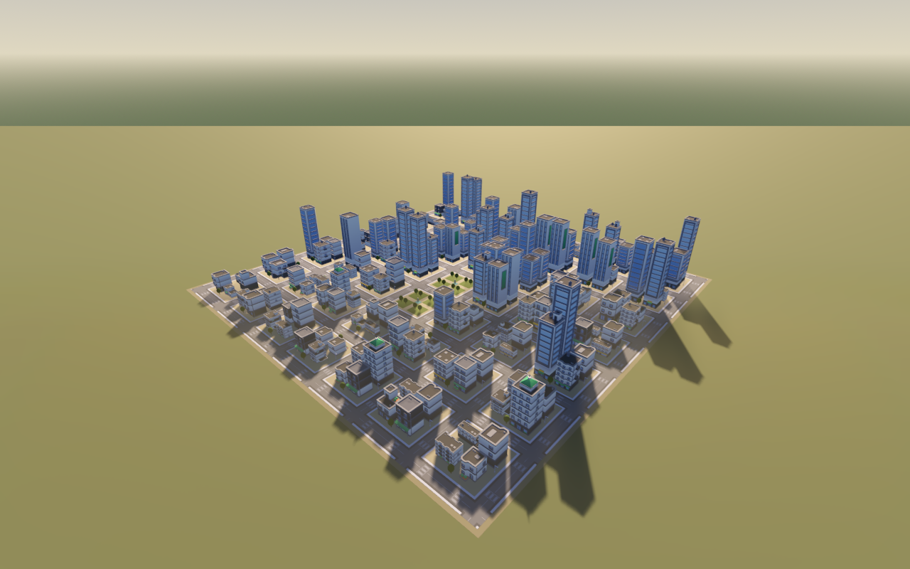
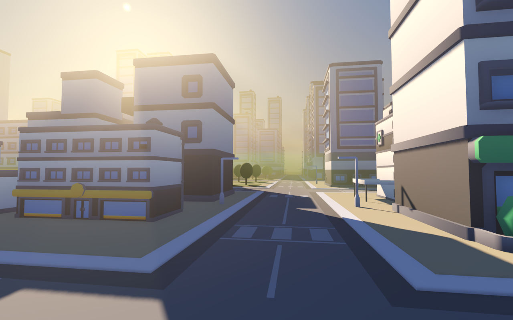

# 城市大气场景

## 场景与来源

`scenes/city.tscn` 是项目默认场景。使用网上下载的 Kenney 模块搭建城市，布局由 `tools/build-city.gd` 生成，固定种子为 `42107`。街区、建筑实例、道路、树木、灯光和相机均保存为编辑器可见的节点。

- [City Kit Commercial](https://kenney.nl/assets/city-kit-commercial)：商业建筑和高楼，CC0。
- [City Kit Roads](https://kenney.nl/assets/city-kit-roads)：道路、路口、人行横道和路灯，CC0。
- 原始许可保存在 `assets/kenney_city/{commercial,roads}/License.txt`；归档下载地址、SHA-256 和文件清单见同目录的 `download-manifest.json`。
- 城市道路覆盖约 464×464 米，街区间距 64 米，道路模块宽 16 米。49 个街区中，46 个布置建筑，3 个布置公园广场，共 184 栋建筑。树木、地基和广场使用本项目的简单几何。



## 运行与操作

Godot 4.6.x / Forward+，在编辑器按 F5；也可以执行：

```powershell
./tools/run-city.ps1
./tools/run-city.ps1 -Capture
```

`F1` 切换城市，`F2` 切换 Sponza（TG GI + 雾），`F3` 切换拱廊。切换会释放鼠标，并等待新场景的 GPU 资源准备好；Sponza 缺少模型或生成数据时会显示准备命令，保留当前场景。Sponza 仍需先按根目录 README 下载和准备。

城市内 `P` 或 `1/2/3` 切换航拍、阳光大道和中央广场。按住鼠标右键转向，WASD 飞行，E/Space 上升、Q 下降，Shift 加速，滚轮调速。航拍初始速度为 22 米/秒，街道为 10 米/秒；不做碰撞。Sponza 内 `1/2` 保留关闭/开启 GI 的原有功能。

`F` 开关雾，`[` / `]` 调整浓度，方向键转太阳，`L` 开关太阳，`G` 切换前向/各向同性散射。`V` 切换 BALANCED / HIGH 采样质量，两档都覆盖整座城市；也可用 `./tools/run-city.ps1 -FullFog` 启动 HIGH。`R` 恢复初始视角和灯光，`H` 隐藏面板。捕获鼠标时 Esc 先释放，再按退出。

左下角统一性能面板每 0.5 秒更新雾和 GI 的独立 GPU 耗时，以及 FPS、帧间隔和当前视口的 CPU/GPU 渲染耗时，单位为毫秒。关闭效果时显示 `OFF`，城市和拱廊的 GI 显示 `N/A (not enabled)`；尚未取得有效采样时显示 `-- (waiting)`。

雾读取当前视口的原生 `> Volumetric Fog` / `< Volumetric Fog` GPU 时间戳，覆盖雾体写入、散射、滤波和积分。GI 读取 TG 计算及历史复制两个独立区间的时间戳之和，排除两者之间的不透明物体绘制。二者都不包含最终材质内的采样开销，也不单独分摊共享阴影成本。切换场景或开关效果后清空均值，并跳过延迟返回的旧查询。

帧间隔按实际时钟测量，包含限帧等待；视口 CPU 数值不包含脚本或其他引擎子系统，视口 GPU 数值包含整个视口。Sponza 右上角仍保留最近 16 帧的 GI 分阶段细表，与左下角 0.5 秒均值的时间窗口不同。

项目开启 `debug/settings/stdout/print_gpu_profile`，让 Godot 在独立运行时也生成原生雾的 GPU 时间戳；引擎会同时输出周期性控制台 GPU 报告。统一面板在渲染线程读取结果，不使用 CPU 计时替代 GPU 查询。正常截图模式隐藏此面板，城市的控制界面截图会显示它。

`./tools/run-city.ps1 -Rebuild` 会按固定种子重建场景文件，覆盖在编辑器里对该文件进行的手工布局调整。平时启动不需要重建。

## 大气与验证

沿用共享 `TGAtmosphere`，距离比例为 1.4、厚度为 0.8、深度分布参数为 2.0，保留原生抖动和时序重投影，运行时同时开启 TAA 与 2× MSAA。方向光阴影范围为 600 米，阴影图分辨率使用项目设置。

2026-10-08 远景修复：撤回固定 160 / 220 米近场加弱 depth fog 的方案。该方案在拉远时无法覆盖城市的世界空间雾层，航拍 480 米固定范围也会失效；仅测三个预设的整图 MAE 没有覆盖这个问题。此前 42%–45% 的雾性能收益属于已撤回配置，不能作为当前版本的结论。

现在从实际 CityBlocks 网格与地基区域计算城市包围盒，每帧将其八个角点投影到相机深度轴，保证体积积分达到城市最远处。保留 128 米余量并向上取整到 128 米档位，收缩使用 256 米滞后阈值，避免细微移动反复重建历史；范围变化会清理旧体积历史。最小范围 480 米，最大为相机远裁剪面 1800 米。固定航拍/街道/广场分别约为 1024 / 640 / 512 米，自由飞行会自动更新。仍使用原高斯密度、实时阴影和体积散射，没有用无阴影的远景颜色替代。

BALANCED 使用 `volume_size=168, volume_depth=192`，HIGH 使用项目设置（当前为 `192 / 192`，并关闭原生 3D 滤波，见 [雾耗时减半](TG_ATMOSPHERE.md#2026-10-25雾耗时减半)）；两档只交换横向采样预算，保持相同完整覆盖范围和 192 层深度。网格大小是 Godot 全局设置，退出城市场景时恢复项目配置。编辑器保存的预览范围及重建脚本同时改为 1800 米，运行时再按相机收紧。

`./tools/validate-city-fog.ps1` 对两个质量档生成 `512 / 384` 高密度参考，并检查移动历史、恢复、零密度、关闭、自由飞远后的自动扩展、范围滞后、宽 FOV 和环境恢复。RTX 5070 / Vulkan / 1280×800 下 BALANCED 三个预设的整图参考 MAE 约 0.00105 / 0.00090 / 0.00082（2026-10-25 改网格前为 0.00147 / 0.00100 / 0.00087），恢复误差 0.00043，移动误差 0.00533，检查通过。当前计时保存在结果文件中，但本次保留了用户编辑器/运行窗口，不作为独占 GPU 性能基准。

该命令还捕获约 566 / 877 / 1301 / 721 米外的城市，与覆盖整个相机远面的高密度体积参考对比。只在参考中雾变化超过 0.03 的像素上评分，防止大面积天空稀释远城错误；修复后雾信号约为参考的 95%–102%，相对参考误差约 2%–9.4%；2026-10-25 改网格后分别为 95.5%–99.7% 和 1.0%–8.5%。旧配置在 877 / 1301 米视角的相对误差约 100%，即几乎完全没有雾。结果及前后截图在 `artifacts/city-coverage/`，普通质量检查在 `artifacts/city-fog/`。参考仍是同一渲染器，不是路径追踪真值。

城市使用 Godot 原生直接光和环境光；没有为城市生成 Sponza 路径专用的 BVH，也没有接入 TG 屏幕 GI。原有 GI 演示及其启动脚本仍可单独运行。保存的 `EditorFog` 用于编辑器预览，运行时由共享大气控制器接管。

`-Capture` 通过真实 Vulkan 渲染输出航拍、街道有雾/无雾、广场和控制界面截图，以及 GPU/建筑数量/重投影状态记录。截图位于 `artifacts/city/`；headless 仅用于导入模型和生成节点，不用作画质验证。

`tools/validate-viewer.gd` 通过真实按键事件验证三场景往返、Sponza 重载、雾/GI 开关、旧计时清理和毫秒量级，结果与截图写入 `artifacts/viewer/`。运行方式：

```powershell
$godot = & ./tools/resolve-godot.ps1
& $godot --path . --rendering-driver vulkan --max-fps 60 --script tools/validate-viewer.gd -- --validate-viewer
```


