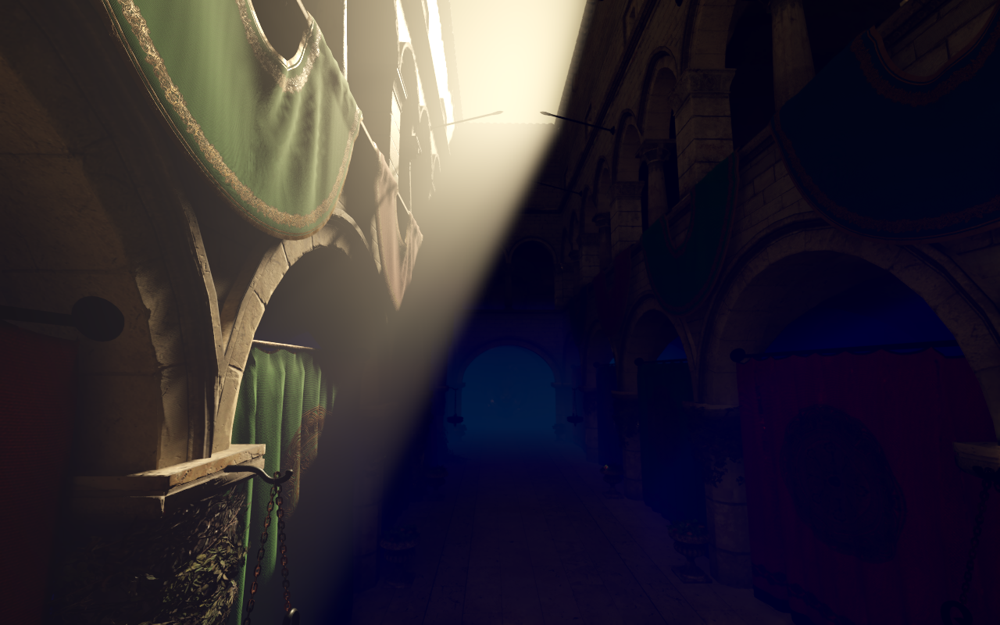

# Tiny Glade 风格大气与阳光体积雾

2026-10-07。依据本机 Tiny Glade `_apply_volumetrics` 编译变体的静态反编译，重新实现密度、散射比例、太阳相函数和天空源项；用 Godot 4.6.1 Forward+ 的体积网格积分和实时阴影完成渲染。重点是被建筑遮挡的阳光在雾中的光束，不依赖太阳出现在屏幕内。



## 运行

沿用项目的 `GODOT_EXE` 配置。在仓库根目录执行：

```powershell
./tools/run-atmosphere.ps1          # 独立拱廊，无需下载模型
./tools/run-atmosphere.ps1 -Capture # Vulkan 画面对照与自动检查
./tools/run-tg.ps1 -Atmosphere      # Sponza + TG GI，需要先准备 Sponza
./tools/run-tg.ps1 -Atmosphere -Capture
```

独立演示：`F` 开关雾，`[` / `]` 调浓度，`G` 切换前向/各向同性散射，`L` 开关太阳，`B` 移动遮挡板，方向键转动太阳。`P` 切换三个相机预设，`R` 恢复初始状态，`H` 隐藏面板。自由相机沿用右键、WASD、Space/Ctrl、Shift 和滚轮。场景是程序生成的验证拱廊，不包含 Tiny Glade 模型。

Sponza：增加 `F`、`[` / `]`、`J/K` 太阳方位、`U/I` 太阳仰角；原有相机、GI 模式和移灯操作保留。大气预设使用暖色太阳，初始关闭蓝色点灯，`L` 可重新打开。`8` 联动开关 GI 天空光、可见天空及雾的天空源项；`-Atmosphere -NoSky` 从关闭天空开始。默认 `run-tg.ps1` 仍运行原有无雾预设。

## 已核实的反编译证据

输入为本地 `D:\MyProject\Tiny Glade\compiled-shaders\_apply_volumetrics.cs.hlsl_cs_main_0.bin`。只读提取内嵌 SPIR-V，经已有 RenderDoc `spirv-cross --vulkan-semantics` 解码。输入 SHA-256：

```text
e41a602c3717ed0ff6ff4d12f45e950ad66d0ac63e047a9d333c481bd3c02474
```

解码输出保存在忽略目录 `artifacts/atmosphere/reference/apply_volumetrics.glsl`。原始二进制和反编译输出不进入仓库。提取方法与 [GI 审计](TINY_GLADE_GI_AUDIT.md#复现本轮静态解码) 相同。

该变体可直接确认：

- 读取场景深度、方向光阴影数组、蓝噪声、HDR 场景颜色；从相机沿视线积分，距离上限 1024。
- 每像素六次抖动采样，采样位置按视线仰角重新分布；逐段查询太阳阴影。没有屏幕中心径向模糊。
- 相函数常数 `0.04595599`、`1.4225`、`1.3` 对应 Henyey–Greenstein 的 `g=0.65`，即 `(1-g²)/(4π)`、`1+g²`、`2g`。
- 基础密度系数是 `0.0125 × global_density_scale × fog_thickness`；散射系数乘 `0.4`，消光系数乘 `1.2`。
- 基础空间分布为 `0.6 × exp2(-dot(p / (300,30,300), p / (300,30,300)))`；坐标尺度受 `global_size_scale` 调整。不同主题对外围雾增加 2/3/4/8 倍权重，主题 2 还存在 0.8 上限。
- 太阳源项乘相函数、阴影、太阳颜色和 4；天空源项随水平半径从 4 增长到 8。入射太阳衰减为 `exp(-base_density × 36 / max(0.3, sun_y))`。
- 每段按 `exp(-sigma_t × density × distance)` 更新透射率，以解析分段积分累加散射，最后合成 `scene × transmittance + scattering × fog_tint`。
- 还存在两路艺术补光及半径 40、高度 18 的解析遮挡近似。

这些是指定编译变体的静态证据。没有原游戏同机位帧捕获，不能据此断言其所有主题、画质档和运行时参数。

## 实现映射

[tg_atmosphere.gdshader](../shaders/tg_atmosphere.gdshader) 向世界形状的 `FogVolume` 写入高斯密度、主题外围权重、雾色和天空源项。`ALBEDO = tint / 3` 对应 `sigma_s / sigma_t = 0.4 / 1.2`；`DENSITY` 表示消光系数。Shader 注释与控制器导出字段是参数定义的主位置。

[tg_atmosphere.gd](../scripts/tg_atmosphere.gd) 配置 `g=0.65`，把原内核的太阳权重和入射衰减映射到 `light_volumetric_fog_energy`。场景坐标统一缩小，消光系数反向放大，以在几十米的测试场景中保留可见光学厚度。移除控制器时恢复原环境和光源的体积雾设置。

实际阴影、体积积分、深度截断和透明物体合成由 Godot 完成。官方接口和实现依据：

- [Godot 4.6 FogVolume](https://docs.godotengine.org/en/4.6/classes/class_fogvolume.html)
- [Godot 4.6 Environment](https://docs.godotengine.org/en/4.6/classes/class_environment.html)
- 本地 Godot `14d19694e` 的 `volumetric_fog.glsl` 与 `volumetric_fog_process.glsl`，已核对密度、散射、发射项和阴影 HG 相函数的计算。

体积网格使用 `volume_size=256`、`volume_depth=192`，默认最大距离 55 米，深度分布 `detail_spread=2.0`。这会把更多采样放在相机附近。默认开启体积雾重投影及原生 Halton 单元内抖动，稳定时历史权重为 0.9；视口 TAA 仍开启。

正常移动相机保留世界空间重投影。切换灯光/参数、移动遮挡或相机跳切时，将历史权重置零两帧，但不关闭抖动开关，从而同时保留及时响应和单元内抗锯齿。低性能设备可降低网格分辨率，但需重新检查噪声、运动拖影和窄光束。

城市的体积范围现在随相机与城市包围盒自动调整，保证自由飞远后仍能积分到城市雾层；两个质量档保留相同完整覆盖，仅调整横向网格预算。固定近场加远景 depth fog 的方案已因远处失雾撤回。Sponza 和拱廊保持本节参数。实现和远距离图像回归见 [城市场景说明](CITY_SCENE.md#大气与验证)。

### 体积雾块状边缘修复

初版使用 `detail_spread=0.65` 且关闭重投影。引擎源码中的深度位置为 `length × pow(normalized_depth, detail_spread)`，小于 1 的指数使近处采样过稀；Godot 又只在重投影开启时执行 Halton 抖动。这使固定的体积网格边界直接出现在光束中，单纯增加横向分辨率不能解决。

现版本修正深度分布与历史管理，没有对最终画面做模糊，也没有改变材质贴图或 GI 采样预算。同机位以 `512 × 384` 设置的高密度体积网格为重建参考，Sponza 整图平均绝对误差由 `0.01505` 降至 `0.00140`，拱廊由 `0.02731` 降至 `0.00092`；分别降低约 91% 和 97%。这个参考来自同一渲染器，不是无偏路径追踪真值。

```powershell
./tools/validate-atmosphere-quality.ps1 -Python python
```

该检查串行捕获旧参数、修复参数、高采样参考、连续相机移动、恢复视角及关闭太阳散射后的画面。结果在 `artifacts/atmosphere-quality/{sponza,courtyard}/quality.json`，并保留 `before.png` / `after.png` / `reference.png` 供直接对照；需要已准备的 Sponza、NumPy 和 Pillow。

### 与 TG GI 共存

Godot 默认把雾合入不透明 HDR，直接复用显示 TAA 会把雾当成表面反弹。2026-10-09 新增独立表面辐射缓存：在支持原生雾缓冲接口的本地引擎中，Sponza 大气预设的材质先输出无雾照明，POST_OPAQUE 先缓存颜色和深度，再由 `TGSurfaceFog` 使用同一份原生积分雾纹理合成。太阳阴影、密度、积分和体积重投影仍由 Godot 完成。

合成写回原有 MSAA 颜色附件，以逐样本深度决定散射和透射；RGB 混合为 `S + T × surface`，保留附件 alpha。天空未覆盖的样本被跳过，随后仍由原生天空与透明物体 pass 处理。没有增加第二次场景几何绘制，也不通过反除透射率从浓雾中猜回表面颜色。

GI 读取双缓冲的干净颜色/深度，使用几何检查、四 tap 重投影、当前邻域限幅及 0.25 新帧权重稳定表面历史。混有背景的 MSAA 轮廓像素不进入表面缓存，屏幕查询不可信时仍回退 BVH。显示端 TAA 继续运行，但不反馈给这条 GI 链路。开关雾、调雾浓度不再重置 GI；光源与遮挡变更保留原有失效机制。1280×800 下，颜色与深度增加一份缓冲，约 12.3 MB；短历史和额外合成有运行成本，本轮不宣称净加速。

接口补丁仅给 `RenderSceneBuffersRD` 增加原生积分雾纹理及长度/深度分布参数的只读访问。纹理由引擎持有，只在当前 render callback 内借用，项目不缓存或释放它。该接口已并入 `engine/rdg-engine.patch`（rdg-engine 分支），合成 pass 是 `modules/tg_gi/TGSurfaceFog.cpp` 中的一个 RDG raster pass（`shaders/tg/TGSurfaceFog.glsl`）：

```powershell
tools\build_engine.bat   # 见 README 的“编译”
./tools/run-tg.ps1 -Atmosphere
./tools/validate-tg-fog-history.ps1 -Python python
```

启动脚本使用 rdg-engine 的构建（`%GODOT_SOURCE%\..\godot-rdg\bin\`），显式 `GODOT_EXE` 仍优先。测试参数 `--tg-native-fog` 可强制旧路径（原生雾 + BVH GI）作对照。

`artifacts/tg-fog-history/comparison.json` 保存 2026-10-09 的 RTX 5070 / Vulkan 验证：

- 相同 BVH GI、关闭时间抖动时，新旧雾合成图像 MAE 为 **0.000020–0.000047**（0–1 RGB）。覆盖无 MSAA、2×/4×/8× MSAA、浓雾、天空边缘和关闭 GI；天空边缘的 P99 为 1/255，其余为零。
- 相同输入序列下，开雾与全程关雾的 **GI SH、表面辐射、几何和历史年龄逐值相同**。十个检查点覆盖调浓度、零密度、恢复、相机移动、遮挡板、点灯开关、关灯恢复与 997×613 缩放；最终显示画面保留应有雾差异。
- 开雾后屏幕查询真实命中约 **6,100–7,100 条/帧**（1280×800），其余继续 BVH。关灯三帧后 GI 与表面缓存 RGB 精确归零；没有把雾的天空散射回灌给物体。
- 自适应采样与新表面历史组合的完整 GI 回归、无接口旧引擎的 BVH 回退、城市/Sponza/拱廊往返均通过，最终日志没有脚本或引擎错误。报告在 `artifacts/tg-fog-history/regression/`、`fallback/` 与 `artifacts/viewer/results.json`。

这里验证的是雾与表面反馈的隔离、合成等价性及功能，不是对无偏多次反弹参考的画质证明。原生引擎、独立场景与城市的雾覆盖策略保持兼容；城市尚未接入这条 Sponza GI。

### 共享天空光源

Sponza 的 GI 天空未命中、背景天空和体积雾现在共用 `sky_color` / `sky_energy`，`sky_enabled` 联动三者。GI 只对向上、全场景无遮挡的射线取光；关闭原生环境光注入，避免给遮蔽处附加常量填充。开关雾或调浓度不改变 GI 天空源，只有天空参数变更才使其历史失效。

雾仍保留自己的径向权重、雾色和入射衰减，GI 尚未计算沿反弹路径的介质消光。这里只统一基础光源，不等于完整大气天空求解；城市与独立拱廊维持原有照明。实现和实际 Vulkan 遮挡、色彩、强度及历史检查见 [共享天空光源](TG_SCREEN_GI.md#2026-10-09共享天空光源)。

## 验证

本机 Godot 4.6.1 custom、Forward+ / Vulkan、RTX 4080，1280×800：

- headless 资源导入/脚本解析通过；GPU 验收使用非 headless Vulkan。
- 独立场景截图检查了无雾、阳光散射关闭、各向同性散射、遮挡板两位置、转太阳、关太阳、零密度、外景、反向观察、恢复视角和操作面板。
- 独立测试的像素 RGB 平均绝对差：阳光散射开关约 `0.1013`，各向异性开关约 `0.0488`，移动遮挡板约 `0.0371`；零密度与无雾误差约 `0.00010`，恢复视角误差约 `0.00054`。数值来自 0–1 的显示图像，属于回归检查，不是辐射真值。
- 初版 Sponza 对照在同一 BVH GI 模式下截取，雾开启后的图像差约 `0.118`；该旧路径在开雾时禁用屏幕查询。后续独立表面历史的验证见上节。
- 新增质量检查确认正常移动时重投影持续生效；关闭太阳散射六帧后与稳定画面的差异小于 `0.0043`，没有持续残留的旧光束。Sponza 和拱廊均通过高采样对照、移动、恢复和关灯检查。
- 原有 `run-tg.ps1 -Capture` 完整回归通过，包括屏幕/BVH 追踪、历史重建、移灯、动态遮挡、关灯归零和窗口缩放。

独立结果位于 `artifacts/atmosphere/results.json`，Sponza 结果位于 `artifacts/atmosphere/sponza/results.json`，原 GI 回归位于 `artifacts/tg/results.json`。启动脚本检查退出码、Godot 错误和结果断言。单次视口 GPU 计时只用于诊断，不是稳定性能结论。

## 边界

这是按已核实公式重新实现的 Godot 版本，不是原游戏着色器的逐指令移植。没有复制六采样蓝噪声调度、两路艺术补光、主题颜色表，也没有原内核对整个画面附加的常数透射率乘数。参数与画面构图是本项目的演示预设。

原生体积网格和阴影分辨率决定窄光束精度；细杆、小孔、远处阴影仍可能出现软化或分段。超出体积雾长度后不继续积累介质；改变世界尺度、视距或阴影范围需一起调整。本次未测移动平台、XR、多视口或其他渲染后端。

独立表面缓存当前只应用于 Sponza 的不透明/alpha-cutout 材质、遮挡板和灯标记，场景未启用普通高度/深度雾。额外透明材质、独立 specular/SSS 管线及普通雾叠加需要另外接入和验证；不应直接将该 compositor 作为任意场景的替代雾方案。采样到的表面反弹尚未包含沿 GI 射线路径的介质消光。
